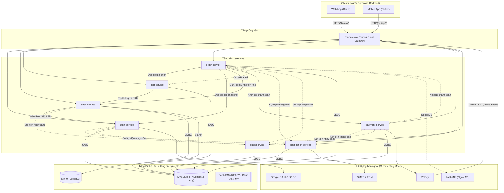
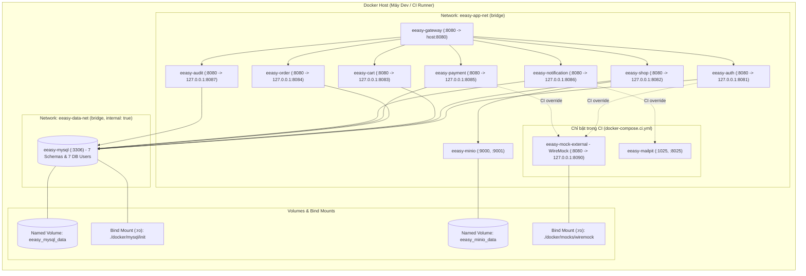
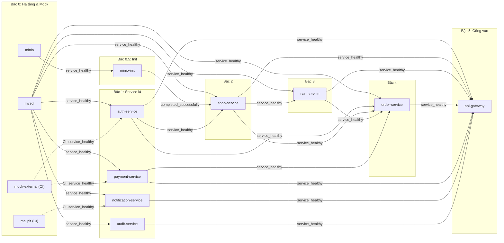

# D.11 — Sơ đồ thành phần và thiết kế triển khai (Deployment)

**Phiên bản:** v0.1 · **Ngày:** 28/10/2026
**Phụ thuộc:** D.1 (`docs/QUY_UOC_KY_THUAT.md`), D.2 (`docs/design/02-boundaries.md`), 1.1 (`docker/Dockerfile.template`), `docs/TECHSTACK.docx`

---

## 1. Phạm vi và nguyên tắc

- **Vai trò tài liệu:** Chỉ đặc tả cấu trúc thành phần (Component) và hạ tầng triển khai container (Deployment, Port, Network, Volume, Biến môi trường, Healthcheck, Thứ tự khởi động, Mock CI) ở mức đủ để viết `docker-compose` (việc 1.2). Chi tiết endpoint, payload, kết quả trả về và mã lỗi thuộc tài liệu **API Design**; luồng tương tác chi tiết thuộc **Sequence Diagram**.
- **Container chạy mặc định (M1 Baseline):**
    - **Ứng dụng (8 container Spring Boot):** `api-gateway` (Spring Cloud Gateway) + 6 service nghiệp vụ (`auth-service`, `shop-service`, `cart-service`, `order-service`, `payment-service`, `notification-service`) + `audit-service` (D.2 §3.7, B8).
    - **Dữ liệu & Lưu trữ:** `mysql` (1 MySQL 8.4 server chứa 7 schema riêng) và `minio` + `minio-init` (Object Storage local theo TECHSTACK mức `CORE`).
- **Container theo Profile / Override:**
    - **CI (`docker-compose.ci.yml`):** `mock-external` (WireMock giả lập Google & VNPay) và `mailpit` (SMTP mock).
    - **Dự phòng (`READY` trong TECHSTACK, chưa bật ở M1):** `rabbitmq` (profile `async`), `redis` (profile `cache`).
- **Ngoài phạm vi Compose này:** Frontend (Web/Mobile) và `Last-Mile` (hệ thống ngoài, ngoài M1).
- **Quy ước đường dẫn & xét quyền:** chỉ các API mở công khai (không cần đăng nhập) mới dùng `/api/public/*`; toàn bộ API còn lại dưới `/api/*` không gắn nhãn riêng, mặc định tự động chặn nếu chưa xác thực hoặc không đủ quyền.

---

## 2. Component Diagram

### 2.1 Sơ đồ thành phần và phụ thuộc

Quy ước nét vẽ:
- `──►` (nét liền): Gọi REST đồng bộ hoặc kết nối DB / Object Storage.
- `-.->` (nét đứt): Phát sự kiện một chiều (M1 đẩy qua HTTP; giai đoạn sau có thể chuyển qua `RabbitMQ`).



### 2.2 Tóm tắt phụ thuộc và định tuyến cơ bản

| Thành phần | Gọi đồng bộ tới | Phát sự kiện một chiều tới | Hạ tầng / Hệ thống ngoài sử dụng | Định tuyến từ `api-gateway` |
|---|---|---|---|---|
| `api-gateway` | 7 backend services | — | — | Cho qua `/api/public/*`; các route `/api/*` còn lại yêu cầu xác thực hợp lệ trước khi chuyển tiếp; chặn `/actuator/*` từ ngoài. |
| `auth-service` | — | `notification`, `audit` | `mysql` (`auth_db`), Google OAuth/OIDC | Nhóm tài nguyên Auth, User, Address, Role, Permission |
| `shop-service` | `auth-service` | `audit` | `mysql` (`shop_db`), `minio` | Nhóm tài nguyên SellerApplication, Shop, Product, SKU, Inventory, Category, ShopCollection |
| `cart-service` | `shop-service` | — | `mysql` (`cart_db`) | Nhóm tài nguyên Cart |
| `order-service` | `cart`, `auth`, `shop`, `payment` | `cart`, `notification`, `audit` | `mysql` (`order_db`) *(sau M1 thêm Last-Mile)* | Nhóm tài nguyên Order, SellerOrder |
| `payment-service` | — | `order`, `notification`, `audit` | `mysql` (`payment_db`), VNPay | Nhóm tài nguyên Payment (gồm cả callback VNPay dưới `/api/public/*`) |
| `notification-service` | — | — | `mysql` (`notification_db`), SMTP / FCM | Nhóm tài nguyên Notification, DeviceToken |
| `audit-service` | — | — | `mysql` (`audit_db`) | Nhóm tài nguyên AuditLog |

---

## 3. Bảng Port của từng Service

**Quy tắc:**
1. **Trong mạng Docker:** cả 8 container Spring Boot đều lắng nghe cổng **`8080`** theo chuẩn `docker/Dockerfile.template`.
2. **Ngoài máy Host (Local / CI):** `api-gateway` mở cổng `8080`; các service con và hạ tầng bind vào `127.0.0.1` để phục vụ debug / chạy test local mà không lộ ra LAN.
3. **Trên Staging / Production:** chỉ mở cổng của `api-gateway` (hoặc Nginx `80/443` phía trước), bỏ mục `ports:` của toàn bộ service con và DB.

| # | Service trong Compose | Container Name | Container Port | Host Port (Local / CI) | Mở ở Prod? | Profile Compose | Ghi chú |
|---|---|---|---|---|---|---|---|
| 1 | `api-gateway` | `eeasy-gateway` | `8080` | `${GATEWAY_PORT:-8080}` | **Có** | *(mặc định)* | Điểm vào duy nhất của hệ thống |
| 2 | `auth-service` | `eeasy-auth` | `8080` | `127.0.0.1:8081` | Không | *(mặc định)* | Auth, User, Address, Role/Permission |
| 3 | `shop-service` | `eeasy-shop` | `8080` | `127.0.0.1:8082` | Không | *(mặc định)* | Shop, Product, SKU, Inventory |
| 4 | `cart-service` | `eeasy-cart` | `8080` | `127.0.0.1:8083` | Không | *(mặc định)* | Giỏ hàng |
| 5 | `order-service` | `eeasy-order` | `8080` | `127.0.0.1:8084` | Không | *(mặc định)* | Đơn hàng & Checkout |
| 6 | `payment-service` | `eeasy-payment` | `8080` | `127.0.0.1:8085` | Không | *(mặc định)* | Thanh toán & VNPay |
| 7 | `notification-service` | `eeasy-notification` | `8080` | `127.0.0.1:8086` | Không | *(mặc định)* | Thông báo, Email, FCM |
| 8 | `audit-service` | `eeasy-audit` | `8080` | `127.0.0.1:8087` | Không | *(mặc định)* | Nhật ký kiểm toán |
| 9 | `mysql` | `eeasy-mysql` | `3306` | `127.0.0.1:${MYSQL_HOST_PORT:-3306}` | Không | *(mặc định)* | Đổi `MYSQL_HOST_PORT=3307` nếu máy dev trùng cổng |
| 10 | `minio` | `eeasy-minio` | `9000`, `9001` | `127.0.0.1:9000`, `127.0.0.1:9001` | Không | *(mặc định)* | `9000`: S3 API · `9001`: Web Console |
| 11 | `minio-init` | `eeasy-minio-init` | — | *(không map)* | Không | *(mặc định)* | Tạo bucket xong tự thoát (`exit 0`) |
| 12 | `mock-external` | `eeasy-mock-external` | `8080` | `127.0.0.1:8090` | Không | `ci` | WireMock giả lập Google & VNPay |
| 13 | `mailpit` | `eeasy-mailpit` | `1025`, `8025` | `127.0.0.1:1025`, `127.0.0.1:8025` | Không | `ci` | `1025`: SMTP · `8025`: HTTP/UI đọc mail test |
| 14 | `rabbitmq` | `eeasy-rabbitmq` | `5672`, `15672` | `127.0.0.1:5672`, `127.0.0.1:15672` | Không | `async` *(READY)* | Giữ chỗ port, chưa chạy ở M1 |
| 15 | `redis` | `eeasy-redis` | `6379` | `127.0.0.1:6379` | Không | `cache` *(READY)* | Giữ chỗ port, chưa chạy ở M1 |

---

## 4. Deployment Diagram (Container, Network, Volume)

### 4.1 Sơ đồ triển khai trên Docker Host



### 4.2 Image và Build Context

| Nhóm Container | Cấu hình Image / Build trong Compose | User chạy |
|---|---|---|
| 8 container ứng dụng (`api-gateway` + 7 services) | `context: ./services/<service-name>`, `dockerfile: ../../docker/Dockerfile.template` (`eclipse-temurin:25-jdk` → `eclipse-temurin:25-jre`). Nếu M1 chưa code kịp nghiệp vụ `notification-service`, dựng project khung tối thiểu từ `examples/sample-service` để hệ thống khởi động đồng bộ. | `app` (non-root) |
| `mysql` | `mysql:8.4` (`--character-set-server=utf8mb4 --collation-server=utf8mb4_0900_ai_ci --default-time-zone=+07:00`) | Mặc định |
| `minio` | `minio/minio:RELEASE.2025-02-28T09-55-16Z` (`server /data --console-address ":9001"`) | Mặc định |
| `minio-init` | `minio/mc:RELEASE.2025-02-21T16-00-46Z` (tạo bucket `${S3_BUCKET_MEDIA}`) | Mặc định |
| `mock-external` *(CI)* | `wiremock/wiremock:3.9.2` | Mặc định |
| `mailpit` *(CI)* | `axllent/mailpit:v1.22` | Mặc định |

### 4.3 Thiết kế Network

| Tên Network | Driver | `internal` | Container tham gia | Mục đích |
|---|---|---|---|---|
| `eeasy-app-net` | `bridge` | `false` | `api-gateway`, 7 backend services, `minio`, `minio-init`, `mock-external`, `mailpit` | Giao tiếp HTTP giữa các container qua DNS tên service và gọi ra Internet khi chạy môi trường thật. |
| `eeasy-data-net` | `bridge` | **`true`** | `mysql` + 7 backend services | Cô lập `mysql` khỏi Internet; `api-gateway` và `mock-external` không tham gia mạng này. |

### 4.4 Thiết kế Volume và Khởi tạo MySQL

| Volume / Đường dẫn Host | Loại | Gắn vào Container | Chế độ | Mục đích |
|---|---|---|---|---|
| `eeasy_mysql_data` | Named volume | `mysql:/var/lib/mysql` | `rw` | Lưu dữ liệu MySQL bền vững ở local (trên CI thay bằng `tmpfs`). |
| `./docker/mysql/init` | Bind mount | `mysql:/docker-entrypoint-initdb.d` | **`ro`** | Chạy `./docker/mysql/init/01-init-schemas.sh` tạo 7 schema + 7 user riêng. |
| `eeasy_minio_data` | Named volume | `minio:/data` | `rw` | Lưu file media upload ở local (trên CI thay bằng `tmpfs`). |
| `./docker/mocks/wiremock` | Bind mount | `mock-external:/home/wiremock` | **`ro`** | Nạp thư mục cấu hình mock `mappings/` và `__files/` cho CI. |

**Danh sách 7 Schema & 7 DB User cần tạo trong `01-init-schemas.sh`** (chỉ tạo schema rỗng và phân quyền cô lập; bảng do **Flyway** của từng service tự tạo):

| Service | Schema | DB User | Quyền (`GRANT`) |
|---|---|---|---|
| `auth-service` | `auth_db` | `auth_user` | Chỉ `auth_db.*` |
| `shop-service` | `shop_db` | `shop_user` | Chỉ `shop_db.*` |
| `cart-service` | `cart_db` | `cart_user` | Chỉ `cart_db.*` |
| `order-service` | `order_db` | `order_user` | Chỉ `order_db.*` |
| `payment-service` | `payment_db` | `payment_user` | Chỉ `payment_db.*` |
| `notification-service` | `notification_db` | `notification_user` | Chỉ `notification_db.*` |
| `audit-service` | `audit_db` | `audit_user` | Chỉ `audit_db.*` |

---

## 5. Biến môi trường (`.env`)

- `.env` không commit lên git; repo lưu sẵn `.env.example` (mẫu cho local) và `.env.ci` (giá trị giả lập cho GitHub Actions).
- Cặp khóa JWT RS256 truyền qua biến môi trường dạng Base64 (`JWT_PRIVATE_KEY_BASE64`, `JWT_PUBLIC_KEY_BASE64`) để không vướng quyền đọc file mount của non-root `USER app`.

### 5.1 Biến dùng chung cho cả 8 container ứng dụng

| Tên biến | Giá trị mẫu | Mô tả |
|---|---|---|
| `TZ` | `Asia/Ho_Chi_Minh` | Đồng bộ múi giờ `UTC+7` (D.1 §5) |
| `SPRING_PROFILES_ACTIVE` | `docker` *(CI: `ci`)* | Profile cấu hình Spring Boot |
| `JAVA_TOOL_OPTIONS` | `-XX:MaxRAMPercentage=75.0 -Duser.timezone=Asia/Ho_Chi_Minh` | Giới hạn bộ nhớ JVM khi chạy nhiều container |
| `CORRELATION_ID_HEADER` | `X-Correlation-Id` | Header truy vết log xuyên service (D.1 §4) |
| `JWT_PUBLIC_KEY_BASE64` | `<base64-rsa-public-key>` | Khóa công khai xác minh chữ ký JWT |
| `JWT_ISSUER` | `eeasyshopping-auth` | Định danh bên phát hành token |

### 5.2 Biến riêng của từng Container

Các service sở hữu DB dùng bộ biến chuẩn `SPRING_DATASOURCE_URL` (`jdbc:mysql://mysql:3306/<schema>?useSSL=false&allowPublicKeyRetrieval=true&serverTimezone=Asia/Ho_Chi_Minh`), `SPRING_DATASOURCE_USERNAME`, `SPRING_DATASOURCE_PASSWORD` cùng các biến sau:

| Container | Biến môi trường riêng |
|---|---|
| `mysql` | `MYSQL_ROOT_PASSWORD`, `DB_AUTH_PASSWORD`, `DB_SHOP_PASSWORD`, `DB_CART_PASSWORD`, `DB_ORDER_PASSWORD`, `DB_PAYMENT_PASSWORD`, `DB_NOTIFICATION_PASSWORD`, `DB_AUDIT_PASSWORD` |
| `minio` / `minio-init` | `MINIO_ROOT_USER`, `MINIO_ROOT_PASSWORD`, `S3_BUCKET_MEDIA=eeasyshopping-media` |
| `api-gateway` | `AUTH_SERVICE_URL=http://auth-service:8080`, `SHOP_SERVICE_URL=http://shop-service:8080`, `CART_SERVICE_URL=http://cart-service:8080`, `ORDER_SERVICE_URL=http://order-service:8080`, `PAYMENT_SERVICE_URL=http://payment-service:8080`, `NOTIFICATION_SERVICE_URL=http://notification-service:8080`, `AUDIT_SERVICE_URL=http://audit-service:8080`, `CORS_ALLOWED_ORIGINS` |
| `auth-service` | DB `auth_db` · `JWT_PRIVATE_KEY_BASE64` *(chỉ cấp cho Auth)*, `JWT_ACCESS_TOKEN_TTL_SECONDS`, `JWT_REFRESH_TOKEN_TTL_SECONDS` · `GOOGLE_CLIENT_ID`, `GOOGLE_CLIENT_SECRET`, `GOOGLE_REDIRECT_URI`, `GOOGLE_TOKEN_URI`, `GOOGLE_JWK_SET_URI` · `NOTIFICATION_SERVICE_URL`, `AUDIT_SERVICE_URL` |
| `shop-service` | DB `shop_db` · `AUTH_SERVICE_URL`, `AUDIT_SERVICE_URL` · `S3_ENDPOINT=http://minio:9000`, `S3_PUBLIC_BASE_URL`, `S3_ACCESS_KEY`, `S3_SECRET_KEY`, `S3_BUCKET_MEDIA`, `S3_REGION=auto` |
| `cart-service` | DB `cart_db` · `SHOP_SERVICE_URL` |
| `order-service` | DB `order_db` · `AUTH_SERVICE_URL`, `SHOP_SERVICE_URL`, `CART_SERVICE_URL`, `PAYMENT_SERVICE_URL`, `NOTIFICATION_SERVICE_URL`, `AUDIT_SERVICE_URL` · `RESERVATION_TTL_MINUTES=15` |
| `payment-service` | DB `payment_db` · `ORDER_SERVICE_URL`, `NOTIFICATION_SERVICE_URL`, `AUDIT_SERVICE_URL` · `VNPAY_TMN_CODE`, `VNPAY_HASH_SECRET`, `VNPAY_PAY_URL`, `VNPAY_API_URL`, `VNPAY_RETURN_URL` |
| `notification-service` | DB `notification_db` · `MAIL_HOST`, `MAIL_PORT`, `MAIL_USERNAME`, `MAIL_PASSWORD`, `MAIL_FROM` · `FCM_ENABLED=false` |
| `audit-service` | DB `audit_db` |

---

## 6. Healthcheck và Thứ tự khởi động

### 6.1 Cấu hình Healthcheck

| Container | Lệnh `test` | `interval` | `timeout` | `start_period` | `retries` |
|---|---|---|---|---|---|
| `mysql` | `["CMD-SHELL", "mysqladmin ping -h 127.0.0.1 -u root -p$$MYSQL_ROOT_PASSWORD --silent"]` | `10s` | `5s` | `30s` | `6` |
| `minio` | `["CMD", "mc", "ready", "local"]` | `10s` | `5s` | `10s` | `5` |
| 7 Backend Services | `["CMD-SHELL", "curl -fsS http://localhost:8080/actuator/health || exit 1"]` | `15s` | `5s` | `45s` | `5` |
| `api-gateway` | `["CMD-SHELL", "curl -fsS http://localhost:8080/actuator/health || exit 1"]` | `15s` | `5s` | `30s` | `5` |
| `mock-external` *(CI)* | `["CMD-SHELL", "curl -fsS http://localhost:8080/__admin/health || exit 1"]` | `5s` | `3s` | `5s` | `5` |
| `mailpit` *(CI)* | `["CMD", "/mailpit", "readyz"]` | `5s` | `3s` | `5s` | `5` |

### 6.2 Thứ tự khởi động (`depends_on`)



---

## 7. Mock Google và VNPay cho CI

Ở mức triển khai container, môi trường CI dùng file override riêng để giữ nguyên image và code của các service, chỉ thay điểm cuối tích hợp ngoài:

- **Lệnh khởi chạy trên CI:**
  ```bash
  docker compose -f docker-compose.yml -f docker-compose.ci.yml --env-file .env.ci up -d --wait
  ```
- **Các thay đổi trong `docker-compose.ci.yml`:**
    1. Bật thêm container **`mock-external`** (`wiremock/wiremock:3.9.2`, mount `./docker/mocks/wiremock:/home/wiremock:ro`), phân tách 2 nhóm đường dẫn `/google/*` (giả lập Google OAuth2/OIDC) và `/vnpay/*` (giả lập cổng thanh toán và API đối soát/hoàn tiền VNPay).
    2. Bật thêm container **`mailpit`** (`axllent/mailpit:v1.22`) nhận SMTP nội bộ cổng `1025` để bài test tự động có thể đọc mail qua cổng `8025`.
    3. Gắn `depends_on: mock-external (service_healthy)` cho `auth-service`, `payment-service` và `mailpit (service_healthy)` cho `notification-service`.
    4. Chuyển lưu trữ của `mysql` và `minio` sang `tmpfs` để mỗi lần chạy pipeline sạch hoàn toàn và khởi động nhanh.
- **Các biến môi trường ghi đè trong `.env.ci`:**
    - `auth-service`: `GOOGLE_TOKEN_URI=http://mock-external:8080/google/token`, `GOOGLE_JWK_SET_URI=http://mock-external:8080/google/jwks`.
    - `payment-service`: `VNPAY_PAY_URL=http://mock-external:8080/vnpay/vpcpay.html`, `VNPAY_API_URL=http://mock-external:8080/vnpay/merchant_webapi/api/transaction`, kèm `VNPAY_HASH_SECRET` cố định dành riêng cho CI để test ký/xác minh callback.
    - `notification-service`: `MAIL_HOST=mailpit`, `MAIL_PORT=1025`.

> Chi tiết cấu trúc dữ liệu stub trả về và các trường hợp lỗi kiểm thử của Google / VNPay được quy định trong tài liệu **API Design** và **Test Specification**.

---

## 8. Cấu trúc thư mục phục vụ việc 1.2

```text
E-Commerce/
├── docker/
│   ├── Dockerfile.template              # Đã có từ việc 1.1
│   ├── README.md                        # Đã có từ việc 1.1
│   ├── mysql/
│   │   └── init/
│   │       └── 01-init-schemas.sh       # Tạo 7 DB + 7 user MySQL tách quyền
│   └── mocks/
│       └── wiremock/
│           ├── mappings/                # Khai báo route mock Google & VNPay
│           └── __files/                 # Dữ liệu mẫu trả về của WireMock
├── services/
│   ├── api-gateway/
│   ├── auth-service/
│   ├── shop-service/
│   ├── cart-service/
│   ├── order-service/
│   ├── payment-service/
│   ├── notification-service/
│   └── audit-service/
├── docker-compose.yml                   # Cấu hình chạy Local / Staging baseline
├── docker-compose.ci.yml                # Override thêm WireMock, Mailpit, tmpfs cho CI
├── .env.example                         # Mẫu biến môi trường (commit)
├── .env.ci                              # Biến môi trường giả lập cho CI (commit)
└── .env                                 # Biến thật tại máy chạy (không commit)
```
